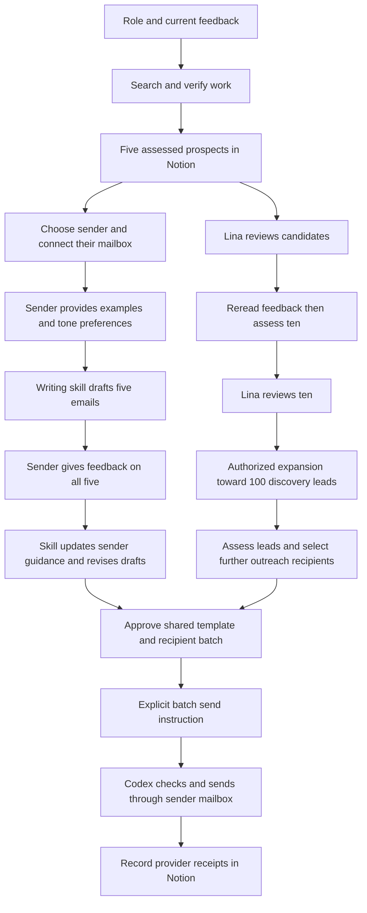

# Bluejay internship review process

The checkpoints and evaluation criteria in README.md explain the rationale and limits behind these branches. Keep candidate-specific decisions and feedback in the private run workspace.

Codex researches, learns the sender's writing preferences and sends approved outreach through connected tools. Notion holds evidence, feedback and delivery records. These instructions guide the agent; they are not an automated enforcement service.

## System flow



The research branch reaches 100 discovery leads with or without a sender handoff. Sender calibration and sending do not replace candidate review or discovery.

## Research decisions

| Decision | Yes | No or unknown |
| --- | --- | --- |
| Role and private destination clear? | Read current brief and feedback | Resolve the consequential gap |
| Identity attributable and profile readable? | Deduplicate and inspect work | Keep unresolved; do not count or attribute code |
| Relevant attributable work? | Apply evidence band, confidence and comparative priority; human decision stays separate | Needs verification; missing public code is not rejection |
| Timing or interest unknown? | Keep feasibility separate from ability | Do not invent availability |
| Lina supplied feedback? | Preserve and reread it | Leave the decision pending |

Use the [evaluation priorities and bands](README.md#candidate-evaluation). Initial screening follows Lina's hierarchy: verified selective technical recognition or similarly strong engineering internships, strong attributable GitHub, then distinguished universities. University-only prospects can Advance with technical evidence still Needs verification. For inspected-work comparisons, depth, end-to-end product building and founder-like initiative carry similar weight; personal contribution and correctness matter across all three and outrank domain keywords. Use qualitative bands and record missing evidence explicitly.

## Candidate review and expansion

```text
Five assessed prospects saved and read back?
  Yes -> stop for Lina's candidate review.
Review and continuation instruction supplied?
  Yes -> reread feedback, then assess ten and prepare requested drafts.
Ten reviewed and expansion requested?
  Yes -> expand toward 100 distinct discovery leads.
Another sender selected or still calibrating?
  Either -> continue authorized discovery; outreach setup is a separate branch.
Source or budget checkpoint reached before 100?
  Yes -> save actual counts and resumable work; mark incomplete.
100 attributable, readable, role-plausible people verified?
  Yes -> discovery complete; assess and approve outreach recipients separately.
```

At each checkpoint, link the exact Notion page and give one next action. First-five review completion triggers rereading feedback and continuing to ten total. Ten-candidate review completion triggers a feedback pass; expansion needs an explicit continuation instruction. Save the current stage and next action privately so a new chat resumes correctly. Follow the conversational prompts in [AGENTS.md](AGENTS.md#guide-lina-through-the-next-step).

## Sender feedback and writing updates

```text
Sender and connected mailbox identified?
  No -> collect setup; continue authorized research.
Tone preferences and writing examples available?
  Yes -> load that sender's private guidance and draft five emails.
Sender feedback on all five recorded?
  No -> wait on sending; continue authorized research.
  Yes -> update sender guidance, version it and revise the drafts.
Feedback conflicts or changes factual claims?
  Yes -> resolve the conflict; verify facts separately.
Sender confirms template/voice and Lina approves recipient batch?
  Yes -> matching emails need no individual copy approval.
```

## Connected sending

```text
Identity-supported recipient address available?
  No -> retain candidate and draft; hold sending for that person.
Sender mailbox, template and recipient batch approved?
  No -> finish setup.
Explicit send instruction covers this batch?
  No -> wait for the instruction.
Mailbox identity, current template, opt-out, pause and duplicates checked?
  No/unresolved -> hold affected item and reconcile.
  Yes -> Codex sends through the connected sender mailbox.
Provider receipt confirmed?
  Yes -> record Sent with message ID, actual sender and time.
  No -> Delivery unknown; reconcile before another attempt.
```

Use [the sender handoff](email-handoff.md) for setup and [sender handoff](email-handoff.md) for style learning.

